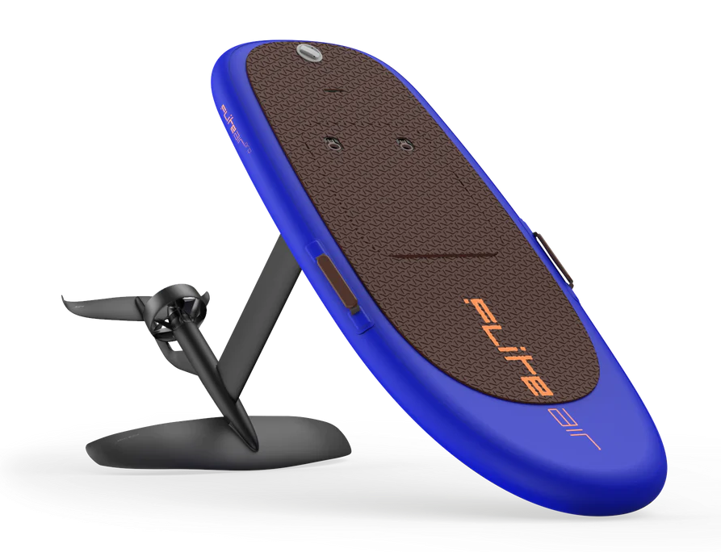

Fliteboard Air Pro (Производитель Fliteboard) 
Электрическая фойл-доска (далее электрофойл). 
Водный электротранспорт, на котором человек перемещается стоя.
Под доской на мачте установлен электромотор и подводные крылья.
<ul>
    <li>Тип местности - Водный </li>
    <li>Тип транспорта - Электрофойл </li>
    <li>Максимальная скорость - 50 км/ч </li>
</ul>

 
 

WayDoo Flyer EVO Pro Plus (Производитель WayDoo) 

<ul>
    <li>Тип местности - Водный </li>
    <li>Тип транспорта - Электрофойл </li>
    <li>Максимальная скорость - 52 км/ч </li>
</ul>